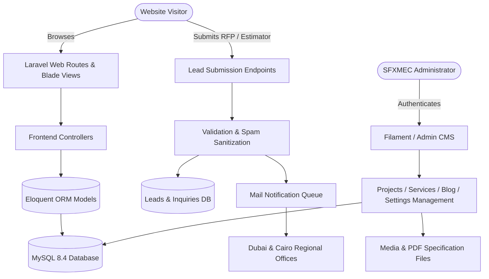
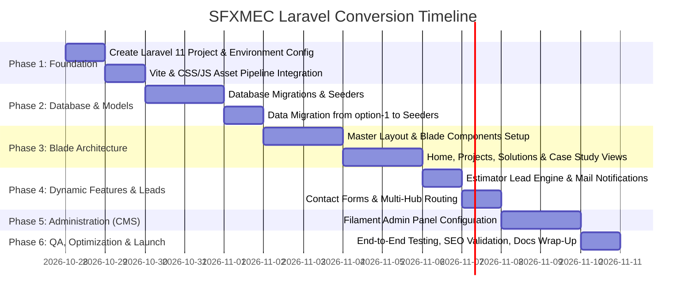

# Structurflex Middle East (SFXMEC) — Laravel Dynamic Website Conversion Plan
**Document Version:** 1.0.0  
**Target Architecture:** Laravel 11.x + Blade Components + Vite + MySQL 8.4 + Filament CMS  
**Source Baseline:** `option-1` (Architectural Tensile & Lightweight Structures Web Platform)  
**Author:** AI Engineering & Architecture Lead  
**Date:** October 2026  

---

## 1. Executive Summary

### 1.1 Objective
The purpose of this project is to convert the high-fidelity static architectural prototype located in [`option-1/`](file:///e:/Nex%20Era/SFX/sfx/option-1) into a fully dynamic, enterprise-grade **Laravel 11** web application for **Structurflex Middle East Contracting LLC (SFXMEC)**.

### 1.2 Core Business Requirements
1. **Preserve Visual Excellence & Identity**: Retain the exact bespoke architectural aesthetics (Obsidian `#070B14`, Desert Gold `#F3B90D`, Tensile Cyan, glassmorphism, and responsive micro-animations).
2. **Empower Non-Technical Management (Full CMS)**: Provide an intuitive, modern administrative dashboard where administrators can add/edit projects, services, technical articles, materials specifications, and site settings without writing code.
3. **Dynamic Estimator & Lead Engine**: Convert the interactive 3D Scope & Cost Estimator and regional contact forms into a secure lead generation pipeline with automated email notifications and CRM logging.
4. **Performance & International SEO**: Ensure sub-second load times, dynamic OpenGraph/Twitter cards, and automated JSON-LD architectural schema markup.

---

## 2. Technology Stack & Local Environment

| Component | Technology / Version | Justification & Role |
| :--- | :--- | :--- |
| **Framework** | **Laravel 11.x** | Industry-standard PHP framework offering robust security, MVC structure, routing, Eloquent ORM, and queuing. |
| **PHP Runtime** | **PHP 8.3+** (Laragon: `C:\laragon\bin\php\php-8.3.30-Win32-vs16-x64`) | Modern JIT performance, typed properties, and active LTS security. |
| **Database** | **MySQL 8.4** (Laragon: `C:\laragon\bin\mysql\mysql-8.4.3-winx64`) | High reliability, relational integrity, JSON support for engineering specs. |
| **Admin Panel** | **Filament v3** (or Custom Blade Admin) | Modern TALL-stack administrative control panel with zero-friction CRUD, media management, and role-based permissions. |
| **Asset Pipeline** | **Vite + Vanilla CSS / JS** | Preserves all custom CSS variables, keyframe animations, and client-side calculators from `option-1`. |
| **Media Storage** | **Laravel Public Disk / Storage Link** | Scalable image uploads with automatic thumbnail generation. |
| **Mail & Notifications** | **Laravel Mailables + Queue** | Instant notification to Dubai/Cairo sales desks upon RFP or Estimator submission. |

---

## 3. System Architecture & Information Structure



---

## 4. Database Schema & Data Models

### 4.1 `project_categories`
| Column | Type | Attributes | Description |
| :--- | :--- | :--- | :--- |
| `id` | `BIGINT UNSIGNED` | Primary Key, Auto Increment | Unique ID |
| `name` | `VARCHAR(100)` | Required | Category name (e.g., "Architectural ETFE/PTFE", "Sports & Stadia", "Air-Supported Domes") |
| `slug` | `VARCHAR(100)` | Unique, Indexed | URL-friendly identifier |
| `filter_tag` | `VARCHAR(50)` | Indexed | Matches frontend filter button (e.g., `architectural`, `sports`, `air-supported`) |
| `sort_order` | `INT` | Default `0` | Display priority |
| `timestamps` | `TIMESTAMP` | Nullable | Created & updated timestamps |

### 4.2 `projects` (Core Portfolio)
| Column | Type | Attributes | Description |
| :--- | :--- | :--- | :--- |
| `id` | `BIGINT UNSIGNED` | Primary Key, Auto Increment | Unique ID |
| `category_id` | `BIGINT UNSIGNED` | Foreign Key -> `project_categories.id` | Project classification |
| `title` | `VARCHAR(255)` | Required | E.g., "Al Jamea Tus Saifiyah ETFE Roof" |
| `slug` | `VARCHAR(255)` | Unique, Indexed | SEO URL slug |
| `location` | `VARCHAR(150)` | Required | E.g., "Nairobi, Kenya" or "Dubai, UAE" |
| `client_name` | `VARCHAR(150)` | Nullable | Client or general contractor |
| `covered_area` | `VARCHAR(50)` | Nullable | E.g., "4,800 m²" |
| `membrane_material` | `VARCHAR(100)` | Nullable | E.g., "Single Skin ETFE with Fluoropolymer coating" |
| `year_completed` | `INT` | Nullable | E.g., 2023 |
| `short_description`| `TEXT` | Required | Summary for cards and listings |
| `full_overview` | `LONGTEXT` | Required | In-depth engineering case study description |
| `structural_challenge` | `TEXT` | Nullable | Engineering problem statement |
| `engineering_solution` | `TEXT` | Nullable | SFXMEC technical execution & membrane solution |
| `thumbnail_image`| `VARCHAR(255)` | Required | Card cover image |
| `is_featured` | `BOOLEAN` | Default `false` | Highlighted on homepage hero/showcase |
| `status` | `ENUM` | `'published', 'draft'` | Publication status |
| `sort_order` | `INT` | Default `0` | Ordering weight |
| `timestamps` | `TIMESTAMP` | Nullable | Created & updated timestamps |

### 4.3 `project_images`
| Column | Type | Attributes | Description |
| :--- | :--- | :--- | :--- |
| `id` | `BIGINT UNSIGNED` | Primary Key, Auto Increment | Unique ID |
| `project_id` | `BIGINT UNSIGNED` | Foreign Key -> `projects.id` | Parent project |
| `image_path` | `VARCHAR(255)` | Required | Storage URL / path |
| `caption` | `VARCHAR(255)` | Nullable | Technical detail description |
| `sort_order` | `INT` | Default `0` | Gallery order |

### 4.4 `services` (Solutions & Capabilities)
| Column | Type | Attributes | Description |
| :--- | :--- | :--- | :--- |
| `id` | `BIGINT UNSIGNED` | Primary Key | Unique ID |
| `title` | `VARCHAR(150)` | Required | E.g., "Architectural Tensile Structures", "Air-Supported Domes" |
| `slug` | `VARCHAR(150)` | Unique | URL slug |
| `subtitle` | `VARCHAR(255)` | Nullable | Tagline |
| `hero_image` | `VARCHAR(255)` | Nullable | Service header visual |
| `icon_name` | `VARCHAR(50)` | Nullable | SVG icon identifier |
| `summary` | `TEXT` | Required | Overview snippet |
| `technical_specs` | `JSON` | Nullable | Key parameters (span capability, fabric types, wind load resistance) |
| `realization_stages` | `JSON` | Nullable | 4-Stage workflow specific to this service |
| `sort_order` | `INT` | Default `0` | Order |

### 4.5 `materials` (Interactive Materials Matrix)
| Column | Type | Attributes | Description |
| :--- | :--- | :--- | :--- |
| `id` | `BIGINT UNSIGNED` | Primary Key | Unique ID |
| `name` | `VARCHAR(50)` | Required | E.g., "PTFE Fiberglass", "ETFE Foil", "PVC/PVDF Composite" |
| `code` | `VARCHAR(20)` | Unique | E.g., `ptfe`, `etfe`, `pvc` |
| `tensile_strength` | `VARCHAR(50)` | Required | E.g., "7,000 / 6,000 N/5cm" |
| `light_transmission`| `VARCHAR(50)` | Required | E.g., "10% – 25% (Translucent)" or "Up to 95%" |
| `solar_heat_gain` | `VARCHAR(50)` | Required | E.g., "Low (Shading Coeff: 0.15)" |
| `expected_lifespan`| `VARCHAR(50)` | Required | E.g., "30+ Years", "50+ Years" |
| `fire_rating` | `VARCHAR(50)` | Required | E.g., "Class A1 / Non-combustible" |
| `self_cleaning` | `VARCHAR(100)` | Required | E.g., "TiO2 Photocatalytic" |
| `typical_applications`| `TEXT` | Required | Recommended use cases |

### 4.6 `estimator_leads` (Cost & RFP Estimator Submissions)
| Column | Type | Attributes | Description |
| :--- | :--- | :--- | :--- |
| `id` | `BIGINT UNSIGNED` | Primary Key | Unique ID |
| `structure_type` | `VARCHAR(100)` | Required | E.g., "Conical Tensile Canopy", "ETFE Skylight", "Air Dome" |
| `footprint_area` | `DECIMAL(10,2)` | Required | Square meters ($m^2$) |
| `membrane_choice` | `VARCHAR(50)` | Required | PTFE, ETFE, PVC |
| `calculated_tonnage`| `DECIMAL(8,2)` | Nullable | Estimated steel/membrane weight |
| `estimated_weeks` | `VARCHAR(50)` | Nullable | Project timeline range |
| `client_name` | `VARCHAR(100)` | Required | Full name of requester |
| `client_email` | `VARCHAR(150)` | Required | Email address |
| `client_phone` | `VARCHAR(50)` | Required | Phone / WhatsApp |
| `company_name` | `VARCHAR(150)` | Nullable | Company / Firm |
| `project_location`| `VARCHAR(150)` | Nullable | City & Country |
| `additional_notes`| `TEXT` | Nullable | Scope notes |
| `status` | `ENUM` | `'new', 'contacted', 'quoted', 'archived'` | Lead status |
| `timestamps` | `TIMESTAMP` | Nullable | Created at |

### 4.7 `contact_inquiries`
| Column | Type | Attributes | Description |
| :--- | :--- | :--- | :--- |
| `id` | `BIGINT UNSIGNED` | Primary Key | Unique ID |
| `name` | `VARCHAR(100)` | Required | Full name |
| `email` | `VARCHAR(150)` | Required | Email |
| `phone` | `VARCHAR(50)` | Nullable | Phone number |
| `subject` | `VARCHAR(200)` | Required | Inquiry category (Dubai Sales, Cairo Sales, Engineering, Careers) |
| `message` | `TEXT` | Required | Message body |
| `attachment_path` | `VARCHAR(255)` | Nullable | Resume / RFP specifications attachment |
| `status` | `ENUM` | `'unread', 'read', 'replied'` | Processing state |

### 4.8 `posts` & `post_categories` (Blog & Technical Articles)
- Columns for `title`, `slug`, `excerpt`, `body` (rich text), `featured_image`, `reading_time_minutes`, `meta_title`, `meta_description`, `published_at`, `status`.

### 4.9 `site_settings` (Global Key-Value Store)
- Dynamic company variables:
  - `contact_email_uae`, `contact_phone_uae`, `address_uae`
  - `contact_email_egypt`, `contact_phone_egypt`, `address_egypt`
  - `whatsapp_number`, `linkedin_url`
  - `stat_completed_projects` (e.g., "9,000+"), `stat_years_experience` ("19+"), `stat_covered_area` ("1.2M m²")
  - `hero_headline`, `hero_subheadline`

---

## 5. Frontend & Blade Template Architecture

To ensure zero regression from the existing high-end look and feel of `option-1`, we maintain a clean component-driven Blade architecture:

```
resources/views/
├── layouts/
│   ├── app.blade.php           # Main HTML shell (head, nav, footer, modals, dynamic SEO meta)
│   └── guest.blade.php
├── components/
│   ├── header.blade.php        # Sticky glassmorphic navbar with active route detection
│   ├── footer.blade.php        # Regional hubs, fast links, legal & copyright
│   ├── project-card.blade.php  # Reusable card with hover zoom, tags & metadata
│   ├── estimator-modal.blade.php# Interactive slider & calculator modal
│   ├── materials-table.blade.php# Dynamic PTFE vs ETFE vs PVC matrix
│   ├── contact-widget.blade.php# Quick WhatsApp & inquiry CTA
│   └── toast.blade.php         # Flash alert messages (Success/Error feedback)
├── pages/
│   ├── home.blade.php          # Dynamic Homepage (Hero, Stats, Matrix, Projects, Estimator, Articles)
│   ├── about.blade.php         # Heritage since 1937, engineering team, Dubai & Cairo presence
│   ├── services/
│   │   ├── index.blade.php     # Solutions grid & 4-stage engineering timeline
│   │   └── show.blade.php      # Dedicated solution details
│   ├── projects/
│   │   ├── index.blade.php     # Filterable portfolio with AJAX/Alpine filter support
│   │   └── show.blade.php      # Full technical case study page with specs & image slider
│   ├── blog/
│   │   ├── index.blade.php     # Technical articles & engineering whitepapers
│   │   └── show.blade.php      # Article detail with related projects & reading progress
│   ├── contact.blade.php       # Dual-hub interactive contact form & Google Map embeds
│   ├── privacy.blade.php       # Dynamic Privacy Policy
│   └── terms.blade.php         # Dynamic Terms & Conditions
```

---

## 6. Dynamic Conversion of `option-1` Features

### 6.1 Interactive Scope & Cost Estimator
- **Current State**: Static JS calculator in `option-1/js/app.js` calculating estimates on the fly.
- **Dynamic Laravel Enhancement**:
  - Formulas and base rates per membrane type can be configured in the database/admin settings.
  - Submitting the form uses a clean RESTful POST endpoint (`/api/estimator/submit` or web form with CSRF).
  - Validates all fields, securely stores in `estimator_leads`, sends notification to sales, and displays instant modal confirmation with reference ID.

### 6.2 Filterable Projects Portfolio
- **Current State**: Hardcoded cards with `data-category` in `projects.html`.
- **Dynamic Laravel Enhancement**:
  - Filter categories loaded directly from `project_categories`.
  - Projects loaded dynamically from `projects` table with eager loading of images.
  - Supports both smooth client-side filtering (preserving current UX) and direct search/category URL routes (`/projects?category=air-supported`).

### 6.3 Technical Case Studies Modals & Detail Pages
- **Current State**: In-page modal with static details.
- **Dynamic Laravel Enhancement**:
  - Every project has its own dedicated SEO-optimized URL (`/projects/{slug}`) for client sharing and search engines.
  - Fast-preview modal on the grid via lightweight JSON endpoint or Blade partial.

### 6.4 Regional Offices & Multi-Hub Inquiries
- **Current State**: Fixed HTML text for Dubai and Cairo offices.
- **Dynamic Laravel Enhancement**:
  - Inquiries routed automatically to the correct regional desk based on user selection or IP detection.
  - File upload support for architectural RFP drawings (PDF, DWG, ZIP) with malware and size validation.

---

## 7. Security, Performance & SEO Strategy

### 7.1 Security Protocols
- **CSRF Protection**: All POST/PUT requests protected via `@csrf`.
- **Input Sanitization**: Strict Laravel `FormRequest` validation classes with honeypot spam protection (e.g. `spatie/laravel-honeypot` or hidden token field).
- **File Upload Guardrails**: Enforce strict MIME-type checks for RFP uploads (maximum 15MB, allowed types: `.pdf`, `.dwg`, `.dxf`, `.zip`, `.jpg`, `.png`).
- **Rate Limiting**: Throttling endpoints to prevent brute-force or spam submissions (e.g., max 5 lead submissions per 10 minutes per IP).

### 7.2 Performance Optimization
- **Asset Minification**: Vite bundling with CSS and JS tree-shaking.
- **Image Optimization**: WebP format with `loading="lazy"` and `srcset` attributes.
- **Caching**:
  - Redis / Database query caching for global site settings and categories (`Cache::rememberForever('site_settings', ...)`).
  - Full route and view caching for production deployment (`php artisan route:cache`, `php artisan view:cache`).

### 7.3 SEO & Structured Data
- OpenGraph & Twitter Card metadata generated dynamically per page, project, and blog post.
- Schema.org JSON-LD dynamically injected:
  - `Organization` / `LocalBusiness` for Structurflex Middle East (Dubai & Cairo branches).
  - `CreativeWork` / `Project` for architectural case studies.
  - `BlogPosting` for technical articles.
- Dynamic `sitemap.xml` and `robots.txt`.

---

## 8. Step-by-Step Implementation Roadmap



### Detailed Phase Breakdown:

#### **Phase 1: Foundation & Scaffold**
1. Initialize a clean Laravel 11 application in `sfx-app` (or workspace root as required).
2. Configure environment file (`.env`) with MySQL 8.4 credentials and Laragon PHP 8.3 binary.
3. Integrate Vite with existing CSS (`option-1/css/style.css`) and JavaScript libraries.

#### **Phase 2: Database & Data Migration**
1. Create migration files for `project_categories`, `projects`, `project_images`, `services`, `materials`, `estimator_leads`, `contact_inquiries`, `posts`, and `settings`.
2. Extract all authentic project records from `option-1/projects.html` (Al Jamea ETFE, Unity Park Addis Ababa, Al Janah Pavilion, Abu Dhabi Shooting Club, etc.) and write a comprehensive database seeder (`OptionOneContentSeeder.php`).
3. Run `php artisan migrate:fresh --seed` to establish an immediately functional, data-rich backend.

#### **Phase 3: Blade Component System & Pages**
1. Build `resources/views/layouts/app.blade.php` with all CSS/JS assets, meta tags, and navigation headers.
2. Port all 8 pages (`index`, `about`, `services`, `projects`, `blog`, `contact`, `privacy-policy`, `terms-conditions`) to dynamic Blade views.
3. Test responsive behaviors across desktop, tablet, and mobile breakpoints.

#### **Phase 4: Dynamic Lead Engines & API**
1. Build `EstimatorController` and `ContactController`.
2. Implement validation with `SubmitEstimatorRequest` and `SubmitContactRequest`.
3. Set up email templates (HTML formatted in the SFXMEC brand colors) using Laravel Mailable (`NewRfpLeadNotification.php`, `LeadConfirmationMail.php`).

#### **Phase 5: Content Management Dashboard (CMS)**
1. Install and configure **Filament v3** (or a bespoke lightweight Laravel admin dashboard).
2. Create Resource managers:
   - `ProjectResource` (with multi-image upload, rich text case studies, category selector).
   - `ServiceResource` (capabilities and specs editor).
   - `MaterialResource` (matrix attributes editor).
   - `EstimatorLeadResource` (inquiry table with lead statuses, export to CSV/Excel).
   - `ContactInquiryResource`.
   - `SettingResource` (phone numbers, emails, hero stats).

#### **Phase 6: Quality Assurance & Launch Preparation**
1. Audit all links, forms, calculations, and image paths.
2. Run automated tests for route status codes and form validation.
3. Prepare production deployment documentation for Apache/Nginx or Laravel Forge/cPanel.

---

## 9. Folder Structure in the Final Laravel Project

```
sfx-app/
├── app/
│   ├── Http/
│   │   ├── Controllers/
│   │   │   ├── HomeController.php
│   │   │   ├── ProjectController.php
│   │   │   ├── ServiceController.php
│   │   │   ├── BlogController.php
│   │   │   ├── ContactController.php
│   │   │   └── EstimatorController.php
│   │   └── Requests/
│   │       ├── SubmitContactRequest.php
│   │       └── SubmitEstimatorRequest.php
│   ├── Mail/
│   │   ├── NewRfpLeadNotification.php
│   │   └── InquiryReceivedConfirmation.php
│   └── Models/
│       ├── Project.php
│       ├── ProjectCategory.php
│       ├── ProjectImage.php
│       ├── Service.php
│       ├── Material.php
│       ├── EstimatorLead.php
│       ├── ContactInquiry.php
│       ├── Post.php
│       └── Setting.php
├── database/
│   ├── migrations/
│   └── seeders/
│       ├── DatabaseSeeder.php
│       └── OptionOneContentSeeder.php
├── public/
│   └── assets/
│       └── images/         # Migrated from option-1/assets/images
├── resources/
│   ├── css/
│   │   └── style.css       # Clean architectural design system tokens
│   ├── js/
│   │   └── app.js          # Estimator engine, navigation & interactive tabs
│   └── views/
│       ├── layouts/
│       ├── components/
│       └── pages/
├── routes/
│   └── web.php             # Clean, descriptive RESTful routes
└── storage/
    └── app/public/         # Uploaded project gallery images & specs
```

---

## 10. Confirmation & Next Steps

Please review this documentation. Once you confirm, we can immediately begin with:
1. **Directory decision**: Setting up the Laravel application inside a dedicated directory (e.g., `sfx-app` or root).
2. **Environment execution**: Running `composer create-project laravel/laravel` using Laragon's PHP 8.3 & Composer binaries.
3. **Database creation**: Configuring the MySQL database and generating the migrations & seeders based on `option-1`.
